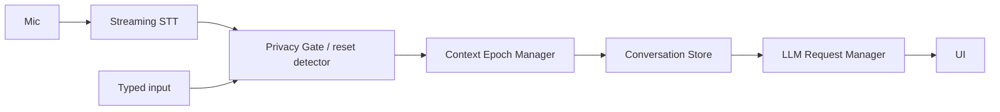

# LiveForget Agent
Voice/text agent where "forget everything I said" is enforced **in application code** before anything reaches the LLM.

## Why prompts aren't enough
A "please forget" prompt still ships the old text to the model (and logs). Here the Privacy Gate removes it first.

## Architecture

- `src/privacy/resetDetector.ts` – word-level phrase registry (normalised, longest-match, earliest-start).
- `src/context/engine.ts` – gate + epoch + store. Every event carries `epoch`; stale STT events, LLM tokens, tool calls are rejected (`OLD_EVENT_REJECTED`). `resetContext()` bumps the epoch, aborts the LLM `AbortController`, clears store/queues. `ask()` asserts all messages share the current epoch or refuses to send.
- Voice and typed input call the same `engine.ingest()`.
- Streaming: a rolling word buffer (committed + interim) is rescanned on every event, so phrases split across events are caught. After a reset, `consumed` skips the pre-reset words of the still-growing interim result. Glue words ("before", "and", "then") right after the phrase are dropped.

## Limitations
- Transcript is normalised (lowercase, no punctuation). No word timestamps are used; if an STT engine *rewrites earlier words* of an interim after a reset, offsets can misalign. A reset is irreversible even if later interim revisions drop the phrase.
- "forget that" / "start over" are broad and may trigger on ordinary speech; edit `RESET_PHRASES`.
- **Cloud STT:** the app deletes *application context*; it cannot delete audio/text a third-party STT provider already received (**provider-side deletion** depends on their retention policy). For the strongest privacy use a local STT adapter.
- Implemented STT adapter: Web Speech (Chrome/Edge/Safari; Chrome sends audio to Google). AssemblyAI, generic WebSocket and local Whisper are interface slots only (factory throws).
- The LLM call is non-streaming plain text through the proxy.

## Run
`npm install` · `npm run dev` · `npm run test` · `npm run build` · `npm run deploy` (gh-pages branch) or push to `main` (Actions workflow).

## Connecting things
1. **Edge proxy:** `cd worker`, create a Cloudflare Worker from `index.ts`; `wrangler secret put ANTHROPIC_API_KEY`, `OPENAI_API_KEY`, `ASSEMBLYAI_API_KEY`; set var `ALLOWED_ORIGIN=https://<user>.github.io`.
2. **Claude / OpenAI:** `provider` is sent by `ProxyLLM` (`'anthropic'` default, `'openai'`).
3. **AssemblyAI:** `/assemblyai-token` mints a short-lived token; write an adapter that streams 16 kHz PCM to AssemblyAI's v3 websocket and implements `SpeechProvider`.
4. **Frontend config:** repo variable `VITE_PROXY_URL` (Settings → Variables); locally copy `.env.example` to `.env.local`. Never commit keys.
5. **GitHub Pages:** Settings → Pages → Source: GitHub Actions. Set `base` in `vite.config.ts` if needed (currently relative).
6. **Microphone:** needs HTTPS (Pages is) and an explicit click on Start Listening; denial shows an error.
